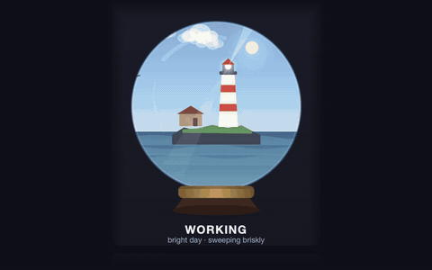
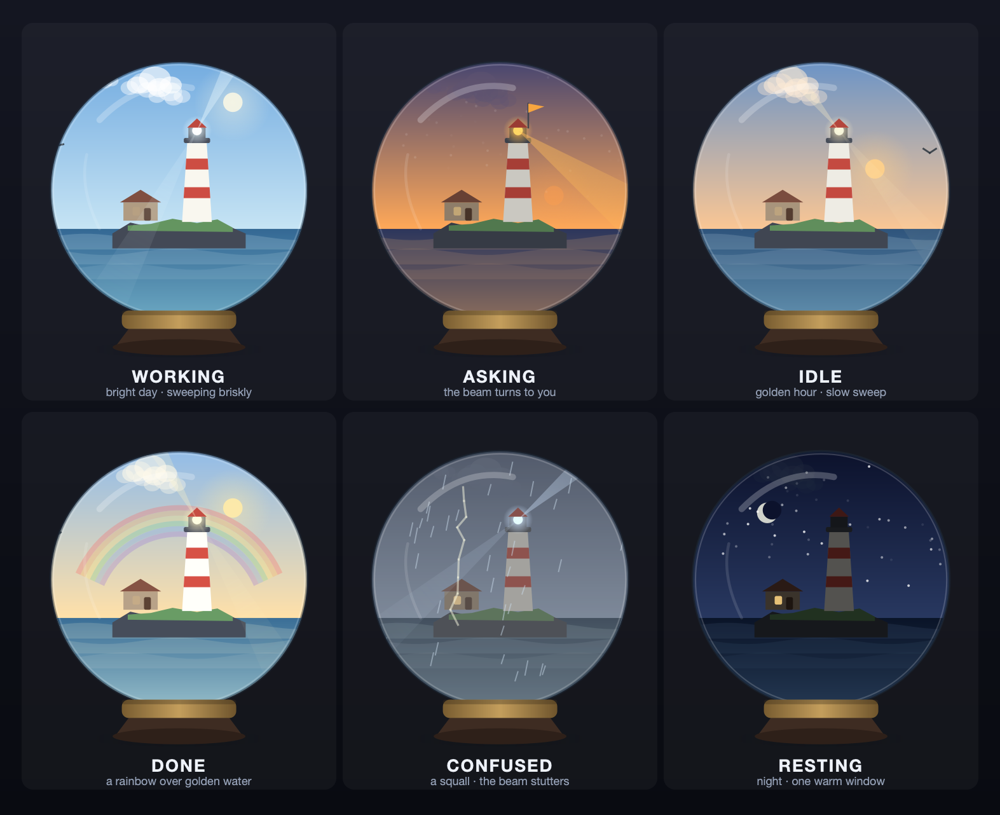
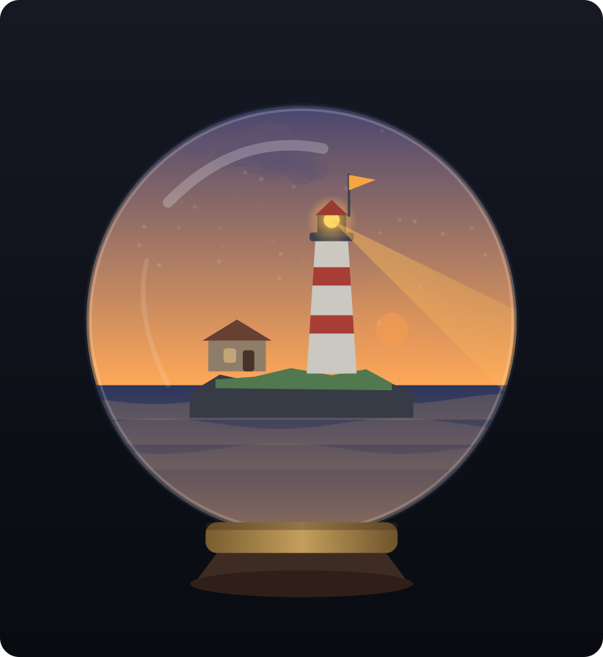
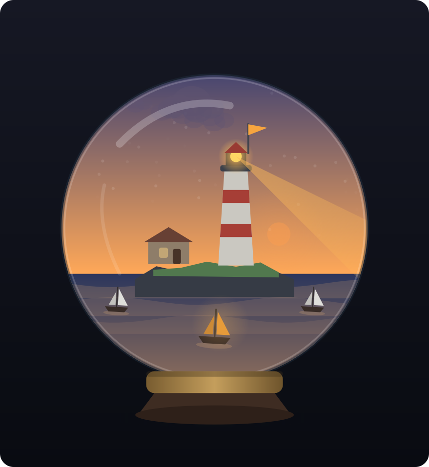
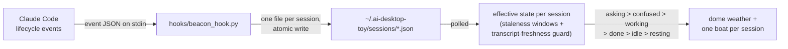

# BEACON, a tiny lighthouse for your AI

> When Claude needs you, the beacon turns to you.
> 它需要你时,光会转向你。

[](https://github.com/lilwan345/beacon/actions/workflows/tests.yml)


[](LICENSE)

<p align="center">
  
</p>

When Claude Code stops to ask you something it just waits, and if you're in
another window you might not notice for a while. Beacon is a little
glass-domed lighthouse that floats above all your windows (even fullscreen
apps) and shows what your agent is doing as weather. When the agent needs you,
the light turns toward you.

<p align="center">
  
</p>

| Claude Code | In the dome |
|---|---|
| **working** | bright day, the lamp sweeps fast and clouds hurry by |
| **asking** | **amber dusk. The beam stops and points at you, a signal flag goes up and a ship's bell rings** |
| **idle** | golden hour, a slow sweep, a few gulls drift through |
| **done** | a rainbow over golden water |
| **confused** | a squall with rain and lightning, the beam stutters |
| **resting** | night. Lamp off, stars out, one warm window in the cottage |

### The moment that matters: *asking*

When Claude hits a question or a permission prompt, the dome turns amber, the
lamp lights up, a flag goes up, the bell rings once, and the beam stops
sweeping and **turns out of the glass toward you**. Which is kind of exactly
what lighthouses are for.

<p align="center">
  
</p>

### A few sessions at once

If you have two or more Claude Code sessions going, each one gets its own
little sailboat, and the sail shows that session's state (white = working,
amber = asking). The dome still shows the overall mood and the boats tell you
**which** session it is. When one starts asking, its boat sails up to the
front row closest to you with a glowing amber sail. **Click a boat** to jump
to that session's terminal.

<p align="center">
  
</p>

## How it works



The hook only uses Python's standard library, prints nothing and always exits
0, so even if it has a bug it can't get in Claude's way. Each session's raw
state gets turned into an *effective* one. A "working" file with no new
activity fades to idle. And if an "asking" file's transcript was written
*after* the question, the prompt was already answered, so it stops counting as
asking.

## Why it looks like this

1. **The metaphor is the function.** A lighthouse is literally there to say
   "you're needed here". So the asking moment isn't a cute animation, it's the
   building doing its one job.
2. **Changes feel like weather.** The whole palette (sky, sea, light) fades
   over about 1.4s. Nothing snaps, dusk just falls.
3. **A diorama, not a pet.** It's supposed to be calm. You glance at it from
   the corner of your eye and it never begs for attention.
4. **Safe on light backgrounds.** Every glow stays on the sky *inside* the
   dome. Nothing bright ever touches your wallpaper, so it can't leave a halo
   on a white page.
5. **Precision over recall.** Only a real permission prompt or a question to
   you counts as *asking*, and only an API error that ends the turn counts as
   *confused*. A failing test or an idle reminder never sets it off. One false
   alarm and people close an ambient tool for good.

## Run

**You need:** macOS · Python 3.9+ · PySide6 (`pip install PySide6`)

```bash
python3 hooks/install.py   # once: registers the hook in ~/.claude/settings.json
./run.sh                   # or: python3 beacon.py
```

The installer backs up `settings.json` first, doesn't touch your other hooks
and is fine to run more than once (`--dry-run` to preview, `--uninstall` to
remove it). New Claude Code sessions pick up the hook. If some other hook is
already writing `~/.ai-desktop-toy/sessions/`, it leaves that one in charge and
changes nothing.

- **Drag** it to move it (the position gets saved in `~/.beacon/window.json`)
- **Click** = knock on the glass. It wobbles and the gulls scatter, and if
  Claude is asking the click brings up the asking session's app. **Click a
  boat** to bring up that session instead
- **Menu-bar lighthouse icon** is the reliable way to control it, because on
  macOS an accessory window never gets keyboard focus: Show/Hide · **Tour
  mode** (cycles through all six states, 6s each, so you can watch the whole
  thing hands-free) · Live · **Force state** · **Sound** (all · alerts only ·
  off, it remembers) · Quit. The current mode has a check mark
- Keys (`1-6` force, `0` live, `T` tour, `ESC` hide) exist but they only work
  where the window can get focus

## Stopping it

```bash
pkill -f beacon.py
```

## Files

```
beacon.py   everything: state detection, sound synth, palettes, renderer,
            widget. Stdlib + PySide6 only.
hooks/      beacon_hook.py (the Claude Code hook, stdlib only) + install.py
run.sh      launcher
tools/      render_shots.py, regenerates the README images offscreen
tests/      headless tests: detection, fleet, hook, installer (pytest)
assets/     the rendered state images
~/.beacon/  its own prefs + generated sounds (the only place it writes)
```

Run the tests with `python3 -m pytest tests/` (needs `pip install pytest`).
The 28 tests don't need a screen. They cover state detection, the false-alarm
guard, the fleet layout, how the hook maps events, and that the installer
keeps a backup, can run twice safely and uninstalls cleanly. CI runs them on
every push. `QT_QPA_PLATFORM=offscreen python3 tools/render_shots.py`
regenerates the README images the same way.

## If I keep going

- A foghorn easter egg on long idle nights.
- Seasons, so the dome's weather drifts with your local time of day.
