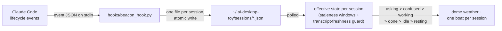

# BEACON — a tiny lighthouse for your AI

> When Claude needs you, the beacon turns to you.
> 它需要你时,光会转向你。

[](https://github.com/lilwan345/beacon/actions/workflows/tests.yml)


[](LICENSE)

<p align="center">
  
</p>

When Claude Code stops to ask you something, it just waits, and if you're in
another window you may not notice for a while. Beacon is a small glass-domed
lighthouse that floats above all your windows (even fullscreen apps) and shows
what your agent is doing as weather. When the agent needs you, the light turns
toward you.

<p align="center">
  
</p>

| Claude Code | In the dome |
|---|---|
| **working** | bright day — the lamp sweeps briskly, clouds hurry |
| **asking** | **amber dusk — the beam stops and points AT YOU, pulsing; a signal flag hoists; a ship's bell rings** |
| **idle** | golden hour — slow sweep, gulls drift through |
| **done** | a rainbow over golden water |
| **confused** | a squall — rain, lightning, the beam stutters |
| **resting** | night — lamp off, stars out, one warm window in the cottage |

### The moment that matters — *asking*

When Claude hits a question or a permission prompt, the dome falls to amber
dusk, the lamp lights, a signal flag hoists, a ship's bell rings once — and
the beam stops sweeping and **turns out of the glass toward you**. A
lighthouse doing the one thing lighthouses do.

<p align="center">
  
</p>

### Several sessions at once — the fleet

With two or more Claude Code sessions running, each one gets a small
sailboat on the sea, its sail showing that session's own state (white =
working, amber = asking). The dome still shows the overall mood; the boats
tell you **which** session it is. When one starts asking, its boat sails to
the front row, nearest you, under a glowing amber sail. **Click a boat** to
jump straight to that session's terminal.

<p align="center">
  
</p>

## How it works



The hook is stdlib-only, prints nothing and always exits 0, so a bug in it can
never get in Claude's way. Each session's raw state is turned into an
*effective* one: a "working" file with no new activity fades to idle, and an
"asking" file whose transcript was written *after* the question means the
prompt was already answered, so it stops counting as asking.

## Design

1. **The metaphor is the function.** A lighthouse exists to signal
   "you're needed here." The asking moment isn't an emote — it's the
   building doing the one thing lighthouses do.
2. **Transitions are weather.** The entire palette (sky/sea/light)
   crossfades over ~1.4s. Nothing swaps; dusk just falls.
3. **A diorama, not a creature.** Calm-tech: glanceable from the corner of
   your eye, zero neediness.
4. **Light-background safety by construction.** Every glow lands on the sky
   *inside* the dome. Nothing luminous ever touches your wallpaper, so it
   can't ring or plate light onto a white page.
5. **Precision over recall.** Only a real permission prompt or a question to
   you becomes *asking*, and only an API error ending the turn becomes
   *confused*; a failing test or an idle reminder never cries wolf. One false
   alarm and an ambient tool gets closed for good.

## Run

**Requires:** macOS · Python 3.9+ · PySide6 (`pip install PySide6`)

```bash
python3 hooks/install.py   # once: registers the hook in ~/.claude/settings.json
./run.sh                   # or: python3 beacon.py
```

The installer backs up `settings.json` first, leaves your other hooks alone,
and is safe to re-run (`--dry-run` to preview, `--uninstall` to remove). New
Claude Code sessions pick the hook up. If other hooks already write
`~/.ai-desktop-toy/sessions/`, it leaves them in charge and changes nothing.

- **Drag** to move (position persists to `~/.beacon/window.json`)
- **Click** = knock on the glass: it wobbles, gulls scatter — and if Claude
  is asking, the click focuses the asking session's app. **Click a boat** to
  focus that session instead
- **Menu-bar lighthouse icon** (the reliable controls — an accessory window
  never gets key focus on macOS): Show/Hide · **Tour mode** (auto-cycles all
  six states, 6s each — watch the whole story hands-free) · Live ·
  **Force state** submenu · **Sound** (all · alerts only · off, remembered)
  · Quit. The current mode is ticked
- Keys (`1-6` force, `0` live, `T` tour, `ESC` hide) exist but only work in
  environments where the window can take focus

## Stopping it

```bash
pkill -f beacon.py
```

## Files

```
beacon.py   everything: state detection, sound synth, palettes, renderer,
            widget. Stdlib + PySide6 only.
hooks/      beacon_hook.py (the Claude Code hook, stdlib only) + install.py
run.sh      launcher
tools/      render_shots.py — regenerates the README images offscreen
tests/      headless tests: detection, fleet, hook, installer (pytest)
assets/     the rendered state images
~/.beacon/  its own prefs + generated sounds (the only place it writes)
```

Run the tests with `python3 -m pytest tests/` (needs `pip install pytest`).
The 28 tests need no screen. They cover state detection, the false-alarm
guard, the fleet layout, how the hook maps events, and that the installer
keeps a backup, can run twice safely and uninstalls cleanly. CI runs them on
every push. `QT_QPA_PLATFORM=offscreen python3 tools/render_shots.py`
regenerates the README images the same way.

## If this were a real product (next)

- A foghorn easter egg on long-idle nights.
- Seasons: the dome's weather drifts with your local time of day.
